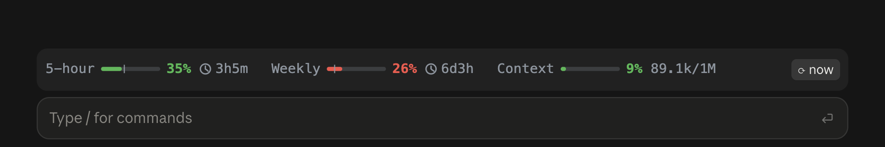

# claude-mods

Small mods for [Claude Code](https://claude.com/claude-code) that spare you surprises and wasted money.



| Mod | Why you want it |
| --- | --- |
| **[limits](limits)** | Shows your 5-hour and weekly usage above the prompt, all the time, with reset countdowns and context fill. Turns red *before* you'd hit a limit, not after. |
| **[idle-compact](idle-compact)** | When you step away from a big chat, it's compacted while the prompt cache is still warm, so coming back costs a fraction of a cold reload. |
| **[check](check)** | `/check` a GitHub, Slack or email link (or your clipboard): Claude reads the whole thread and the code, then gives you where it stands, the next step and a reply ready to paste. |

## Install

Run these in a terminal `claude` session:

```
/plugin install limits --marketplace Ryan-LT/claude-mods
/plugin install idle-compact --marketplace Ryan-LT/claude-mods
/plugin install check --marketplace Ryan-LT/claude-mods
```

The first time, answer `y` to add the marketplace, then choose the **user** scope. That's all: no config, and no restart for the current session. Once installed at user scope, they also load in the Claude desktop app's Code tab.

To update later: `/plugin marketplace update claude-mods`.

## License

MIT
