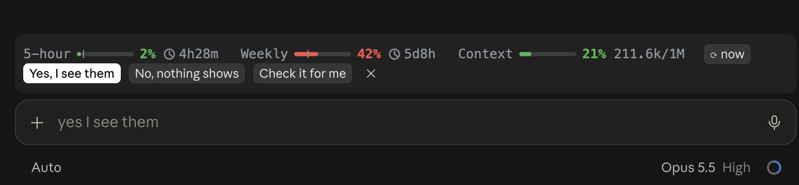

# quick-replies

**Answer Claude in one click.** When Claude ends a reply with a question, an offer or a step for you, pills appear above the prompt with what you'd most likely say: `Yes`, `No`, `Confirm`, `Check it for me`, or the options it just listed. Click one and it's sent as your message.



- **Fits the reply.** Haiku reads the end of Claude's message (and your last prompt) and suggests up to 4 short replies, in your language.
- **Cheap.** Haiku is only asked when the reply actually asks or offers something; a plain report shows no pills and costs nothing. Each ask is a few hundred Haiku tokens.
- **Out of the way.** Pills hide while Claude is working and clear when you send anything. `✕` dismisses them.
- **Free extra.** With Claude Code's prompt suggestions on, its own guess at your next prompt joins the pills.

Settings (`/config`, or `pluginConfigs` in settings): `mode` is `ai` (default), `rules` (simple patterns, no tokens) or `off`.

Works in the terminal and the desktop app's Code tab. It shares the band above the prompt with [limits](../limits): bars on top, pills underneath.

## Install

Run this in a terminal `claude` session:

```
/plugin install quick-replies --marketplace Ryan-LT/claude-mods
```

Answer `y` to add the marketplace, then choose the **user** scope.
